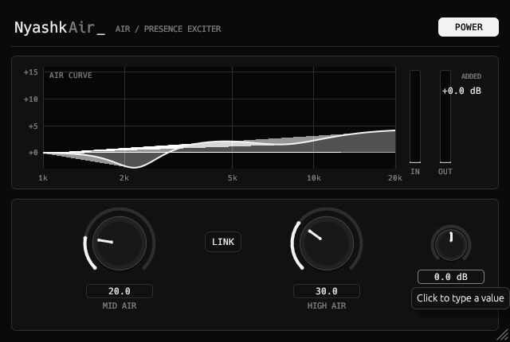

<div align="center">

# NyashkAir

Air / presence exciter VST3 plugin: MID AIR and HIGH AIR with dynamic reduction and a live curve.

[](https://github.com/xslimakx/NyashkAir/actions/workflows/build.yml)
[](LICENSE)


[**Download**](https://github.com/xslimakx/NyashkAir/releases/latest)

</div>

<p align="center"></p>

## Install
Use the Nyashk Launcher, or unzip the `.vst3` bundle from the latest release into your VST3 folder.

## Build
```
cargo xtask bundle -p nyashkair --release
```
The bundle appears in `target/bundled/`.

## License
MIT
